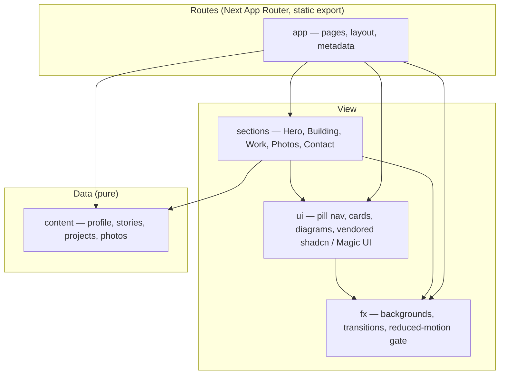
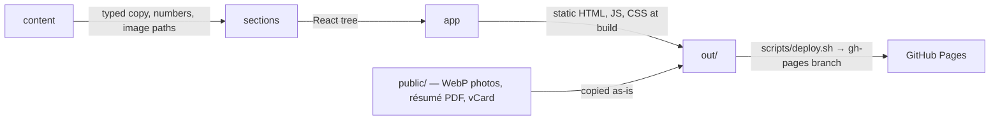

# Architecture

Read this before planning any change. If code contradicts this map, flag it.

## Bootstrap Status

- **Proposal, not a description:** no code exists yet (2026-10-12). This map is what M1 builds against; hand review promotes it, and sign-off deletes this section.
- Assumes page model A (one scrolling home + separate Photos and project routes; `docs/2026-10-12-build-program-v1.md` §Decisions needed). Model B adds routes under `app`, no new modules.

## Module View

- Folders: `src/app`, `src/sections`, `src/ui`, `src/fx`, `src/content`; static files in `public/`.

## Modules

- **app** — routes and the shared layout (pill nav, theme, page transition host); no copy, no layout logic beyond composition.
- **sections** — one component per page section, composed from `ui` and `fx`, filled from `content`.
- **ui** — presentational building blocks with no knowledge of which section uses them.
- **fx** — every animation and canvas effect, and the one place `prefers-reduced-motion` and pause state are read.
- **content** — every word, number and image path on the site, as typed data.

## Invariants

- **content imports nothing from `src/`** and no React — contract: `content-pure`.
- **ui and fx never import sections or app** — contract: `no-upward`.
- **sections never import each other** — contract: `sections-isolated`.
- **only `fx` and `ui` import `motion`**; sections animate through them — contract: `motion-gated`.
- **no server code**: `output: 'export'`; no route handlers, no server actions — check: `pnpm build` emits `out/` and fails on either.

## Ownership

- **This file owns:** modules, dependency direction, invariants, folder map, data flow.
- **`CONTEXT.md` owns:** what the site says, how it looks and moves, decided vs open.
- **Feature PRDs own:** one journey's observable behavior.

## Data Flow

